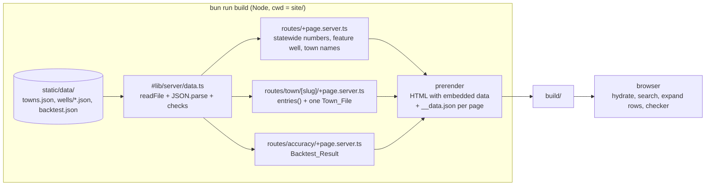

# Design Document: salt-site

## Overview

The site is a SvelteKit 3 app in `site/`. adapter-static prerenders it into plain files: `/`, `/accuracy`, and one page per town (328 today). Every number comes from `site/static/data/`, read with `node:fs` inside `+page.server.ts` loads during the build. Each page's data is serialized into its own HTML, so a browser never requests a Data_File. The town search, the well rows, and the MassDOT checker run on that embedded data.

The logic that can be wrong lives in plain TypeScript modules: Display_Name and number formatting, search matching, statewide stats, chart geometry, the MassDOT rule, and the accuracy sentence. Formatting, search, the MassDOT rule, and chart scale have plain example tests. Svelte components are thin renderers over those modules. All charts are hand-written inline SVG from one `Chart.svelte`.

Facts this design relies on, and where they came from:

- Data on disk (read with a script over `site/static/data/`): 328 Town_Files, 5,672 Wells, 2,974 Trended_Wells, 856 rising (28.8%). Largest Town_File is `carver.json` with 200 Wells, 84,489 bytes raw and 8,657 bytes gzipped. Every Series is already sorted by date. 2,152 samples share a date with another sample in the same Series, 26 multi-sample Series have a single date, and 1,718 Series have exactly one sample. The largest value is 9,200 mg/L. The Feature_Well has 11 sodium samples from 1993-06-23 (7.73) to 2026-01-15 (127.0). `class` takes `COM`, `NC`, `NTNC`; `raw_or_finished` takes `R`, `F`. In `pipeline/trends.py`, `latest` is the value of the last sample after sorting by date, so the last sample in `samples` and `latest` always agree.
- SvelteKit 3 moved project config from `svelte.config.js` into the `sveltekit()` Vite plugin, replaced `$lib` with a `#lib` subpath import declared in `package.json`, and made any `server` directory server-only ([Migrating to SvelteKit 3](https://svelte.dev/docs/kit/migrating-to-sveltekit-3)).
- adapter-static is configured in `vite.config.ts`, needs `export const prerender = true` in the root layout, and has a `fallback` option for a not-found page ([adapter-static](https://svelte.dev/docs/kit/adapter-static)).
- `entries()` on a dynamic route tells the prerenderer which params to render; it can be async ([Page options](https://svelte.dev/docs/kit/page-options)). `prerender.handleHttpError` defaults to `'fail'`, so a failing page fails the build ([Configuration](https://svelte.dev/docs/kit/configuration)).
- `resolve('/town/[slug]', { slug })` from `$app/paths` builds a path from a route id ([$app/paths](https://svelte.dev/docs/kit/$app-paths)).
- Tailwind v4 on SvelteKit uses the `@tailwindcss/vite` plugin and `@import "tailwindcss"` in a CSS file, with no `tailwind.config.js` ([Tailwind SvelteKit guide](https://tailwindcss.com/docs/installation/framework-guides/sveltekit)).
- `sv create` options and add-on option syntax are from the [sv create](https://svelte.dev/docs/cli/sv-create) and [sv add](https://svelte.dev/docs/cli/sv-add) docs. The generated files were confirmed by running `sv@1.1.1 create` into a throwaway `/tmp` directory.
- `serve` sends `404.html` for missing paths and serves `.html` files without the extension ([serve-handler](https://github.com/vercel/serve-handler)).

## Architecture

### Stack and versions

Latest versions from `npm view` today, and the ranges the `sv@1.1.1` scaffold writes. We keep the scaffold's majors and pin exact versions after install.

| Package | npm latest | Scaffold range | Use |
| --- | --- | --- | --- |
| `@sveltejs/kit` | 3.1.0 | ^3.0.0 | framework |
| `svelte` | 5.57.2 | ^5.57.1 | components, runes |
| `@sveltejs/adapter-static` | 4.0.0 | ^4.0.0 | static output |
| `@sveltejs/vite-plugin-svelte` | 7.3.1 | ^7.2.0 | peer of kit |
| `vite` | 8.3.5 | ^8.3.0 | build |
| `tailwindcss`, `@tailwindcss/vite` | 4.3.3 | ^4.3.0 | styles |
| `typescript` | 7.0.2 | ^6.0.3 | types (stay on 6, the scaffold's pick) |
| `svelte-check` | 4.7.7 | ^4.6.0 | `bun run check` |
| `vitest` | 5.0.5 | ^4.1.8 | tests (stay on 4, the scaffold's pick) |
| `serve` | 14.2.6 | not installed | `bunx serve` for the manual check |

Local toolchain: bun 1.4.3, Node 26.7.0. SvelteKit 3 needs Node 22.17 or later.

Every package is a dev dependency, because the built site has no runtime `node_modules`.

### Project setup

Scaffold into the existing `site/` folder. `--no-dir-check` is needed because `site/static/data/` already exists. The minimal template writes only `static/robots.txt` under `static/`, so the data files are left alone.

```sh
bunx sv@1.1.1 create --template minimal --types ts \
  --add sveltekit-adapter="adapter:static" tailwindcss="plugins:none" vitest="usages:unit" \
  --install bun --no-dir-check site
```

After that:

- Delete `src/lib/vitest-examples/`. Replace the Svelte favicon with a plain one. The site keeps a favicon because without one browsers request `/favicon.ico` and get a 404, which breaks Req 1.9.
- Rewrite the caret ranges in `package.json` to the exact versions bun resolved.
- Change the `test` script from `npm run test:unit -- --run` to `vitest run`, so bun never shells out to npm.
- In `vite.config.ts`, pass `adapter({ fallback: '404.html' })`. Keep the scaffold's `compilerOptions.runes` function. It forces runes mode, which makes `export let` and `$:` compile errors, so the compiler enforces Req 1.1.
- Keep the scaffold's `tsconfig.json` (`extends: "$app/tsconfig"`, `strict: true`).
- Keep `lang="en"` in `src/app.html` (Req 2.10).

Imports use `#lib/...` with the `.js` extension for TypeScript modules (`#lib/format.js`), following the migration guide's example.

### Build-time data flow



Loads run only during the build. The browser gets page data in two ways: embedded in the HTML on first load, or from the prerendered `__data.json` on client-side navigation. Both are own-origin files and neither is a Data_File.

### Reading data: fs, fetch, or import

| Option | What it costs | Verdict |
| --- | --- | --- |
| `readFile('static/data/...')` in a `+page.server.ts` load | One small helper. ENOENT errors already include the path. | Chosen |
| `fetch('/data/...')` in a load during prerender | Needs a `res.ok` check and parse handling at each call. In a universal `+page.ts` it would also run in the browser on client navigation and request Data_Files, which breaks Req 5.6. | Rejected |
| `import` of JSON (`import.meta.glob` for wells) | Bundles 4 MB of JSON into the server build. Types are inferred from the literals, not from our declared types. | Rejected |

`fs` is the simplest way to meet Req 1.3, 5.6, and 13.1. The readers live in `src/lib/server/data.ts`, and SvelteKit 3 refuses to bundle a `server` directory into client code. That makes "the browser never reads a Data_File" structural rather than a convention.

Paths are relative to `process.cwd()`, which is `site/` for `bun run build`, `bun run check`, and `bun run test`. `import.meta.url` is not an option, because the bundled server code runs from `.svelte-kit/output/` and its relative path to `static/` differs from the source tree.

### Routes and prerendering

- `src/routes/+layout.ts` exports `prerender = true`. `trailingSlash` stays at its default `'never'`, so pages are written as `build/index.html`, `build/accuracy.html`, and `build/town/<slug>.html`.
- `src/routes/town/[slug]/+page.server.ts` exports an async `entries()` that returns `{ slug }` for every Town_List entry (Req 1.2, 7.1). The crawler could not find town pages on its own, because search options are not `<a>` links.
- A load that throws turns its route into a 500 during prerender. With `handleHttpError: 'fail'` (the default) the build exits non-zero and prints the route. SvelteKit's default `handleError` logs the thrown `Error`, whose message names the Data_File (Req 1.3).
- Unknown town slugs (Req 7.5): `adapter({ fallback: '404.html' })` writes a client-rendered shell to `build/404.html`. Static hosts that support `404.html` serve it with status 404 for any missing path. Checked for `serve` (serve-handler docs) and GitHub Pages (adapter-static docs); not checked for other hosts. The shell starts the router, which requests `/town/<slug>/__data.json`. That request gets a 404, so `+error.svelte` renders, and it says `Town not found` for `/town/` paths. In `bun run dev`, the town load throws `error(404, 'Town not found')` itself.

### Payload per page

- Home: the 328 town `{ name, slug }` pairs for search (about 10 KB raw), the three statewide numbers, and the Feature_Well's name, system, and 11 samples. No Town_File reaches the client (Req 5.6).
- Town: the Town_List entry plus the Town_File. The worst case is Carver, with 200 Wells: 84 KB raw and 8.7 KB gzipped, plus 200 small sparkline SVGs in the HTML. The average Town_File is about 12 KB. That is acceptable, so the Town_File ships unchanged. Dropping unused fields such as `slope` would save little and add a mapping step.
- Detail_Charts render only when a row opens, so the DOM stays at one hidden empty row per Well until the user asks for a chart.

## Components and Interfaces

### File layout

```
site/
  package.json                   scripts, "imports" (#lib), exact versions
  vite.config.ts                 tailwindcss(), sveltekit({ runes, adapter({ fallback: '404.html' }) }), vitest project
  tsconfig.json                  extends $app/tsconfig, strict
  src/
    app.html                     lang="en"
    lib/
      types.ts                   Data_File types
      format.ts                  Display_Name, one-decimal values, counts, Missing_Text
      search.ts                  town matching and option index wrap
      stats.ts                   statewide numbers
      chart.ts                   scales, ticks, paths, accessible names, stroke styles
      massdot.ts                 input parsing, trigger rule, result text
      accuracy.ts                caught share, meaning sentence
      server/data.ts             fs reads and checks of Data_Files
      Chart.svelte               Home_Chart, Sparkline, Detail_Chart
      TownSearch.svelte          combobox
      WellRow.svelte             Well_Row + Detail_Chart row
      Checker.svelte             MassDOT_Checker
      assets/favicon.svg
      format.test.ts, search.test.ts, massdot.test.ts, chart.test.ts
    routes/
      layout.css                 Tailwind import, theme colors, focus ring, color-scheme
      +layout.ts                 prerender = true
      +layout.svelte             Header, <main>, Footer
      +error.svelte              not-found and other errors
      +page.server.ts            home load
      +page.svelte               Home_Page
      town/[slug]/+page.server.ts   entries(), town load
      town/[slug]/+page.svelte      Town_Page
      accuracy/+page.server.ts      backtest load
      accuracy/+page.svelte         Accuracy_Page
```

### `format.ts`

```ts
export const MISSING = 'n/a';

/** Upper-cases the first letter of each space-separated word and lower-cases the rest. Keeps spacing. */
export function titleCase(name: string): string;

/** x rounded to an integer count of tenths, halves away from zero. */
export function tenths(x: number): number;

/** Exactly one decimal place from tenths(x), no grouping: 122 -> "122.0", 6.25 -> "6.3". */
export function fixed1(x: number): string;

/** mg/L value or Missing_Text. No unit is appended; headers and labels carry "mg/L". */
export function mgl(x: number | null): string;

/** fixed1(x) + "%" or Missing_Text. */
export function pct(x: number | null): string;

/** Integer with en-US grouping: 856 -> "856", 5672 -> "5,672". */
export function count(n: number): string;

/** part / whole * 100, or null when whole is 0. */
export function percentOf(part: number, whole: number): number | null;
```

`tenths` is `Math.sign(x) * Math.round(Number((Math.abs(x) * 10).toPrecision(15)))`. The `toPrecision(15)` strips binary noise first: `1.45 * 10` is `14.499999999999998` in floating point and becomes `14.5`. Then `Math.round` on the absolute value rounds halves up, which is away from zero. `fixed1` builds its string from that integer (`${Math.trunc(t / 10)}.${Math.abs(t % 10)}` plus the sign) instead of calling `toFixed`, because `toFixed` rounds the binary value and gives `(1.45).toFixed(1) === "1.4"`. A zero result is never signed.

`titleCase` is `name.split(' ').map((w) => w.charAt(0).toUpperCase() + w.slice(1).toLowerCase()).join(' ')`. Splitting on single spaces keeps the original spacing, which is what makes the lower-case round trip in Req 3.2 exact.

`count` uses `new Intl.NumberFormat('en-US', { maximumFractionDigits: 0 })`. The locale is fixed, so prerendered HTML and hydrated output match.

### `search.ts`

```ts
export const MAX_OPTIONS = 8;

/**
 * Towns whose name contains text.trim(), ignoring case. Prefix matches come first;
 * each group is sorted by name in code-unit order (the same order as towns.json). At most 8.
 * Returns [] when the trimmed text is empty.
 */
export function matchTowns<T extends { name: string }>(towns: readonly T[], text: string): T[];

/** Next active option index. From -1 (none), step 1 gives 0 and step -1 gives count - 1. Wraps at both ends. */
export function nextIndex(current: number, count: number, step: 1 | -1): number;
```

### `stats.ts`

```ts
export interface Statewide {
  wells: number;
  trended: number;
  pctRising: number | null; // percentOf(rising, trended); null when trended is 0
}

export function statewide(files: readonly TownFile[]): Statewide;
```

### `chart.ts`

```ts
export const GUIDELINE = 20;
export type Chemical = 'sodium' | 'chloride';

export interface PlotSeries { chemical: Chemical; samples: readonly Sample[] }
export interface Frame {
  width: number;
  height: number;
  margin: { top: number; right: number; bottom: number; left: number };
}
export interface Tick { pos: number; label: string }
export interface Point { x: number; y: number }
export interface PlottedSeries {
  chemical: Chemical;
  points: Point[];   // one per sample, in date order
  d: string | null;  // SVG path through points; null when there is one point
}
export interface Plot {
  left: number; right: number; top: number; bottom: number; // plot area in px
  series: PlottedSeries[];  // only series with samples
  guidelineY: number;
  xTicks: Tick[];           // year labels
  yTicks: Tick[];           // mg/L labels, first is 0
}

/** "YYYY-MM-DD" to UTC milliseconds. */
export function dayMs(date: string): number;

/** Linear map from [d0, d1] to [r0, r1]. When d0 === d1, every value maps to the middle of the range. */
export function linear(d0: number, d1: number, r0: number, r1: number): (v: number) => number;

/** Smallest 1, 2, or 5 x 10^k step giving at most `target` steps up to max; top is max rounded up to a step. */
export function niceTop(max: number, target: number): { top: number; step: number };

/**
 * Year labels at January 1, using the smallest step in [1, 2, 5, 10, 20, 50, 100] years
 * that gives between 1 and maxCount labels. If no January 1 falls inside [t0, t1], all
 * dates are in one calendar year, so the result is one label with that year at the middle.
 */
export function yearTicks(t0: number, t1: number, x: (t: number) => number, maxCount: number): Tick[];

/** Geometry for one chart. Returns null when no series has samples. */
export function plot(series: readonly PlotSeries[], frame: Frame, minLabelGap: number): Plot | null;

/** Accessible name, e.g. "Sodium: 11 samples, first 1993-06-23 7.7 mg/L, latest 2026-01-15 127.0 mg/L." One clause per plotted chemical. */
export function chartLabel(series: readonly PlotSeries[]): string;

/** Stroke color and dash pattern shared by charts and legends. */
export const STROKE: Record<Chemical | 'guideline', { color: string; dash: string | null }>;
```

How `plot` works:

- Sorts each series by date (stable). The data is already sorted, but sorting here makes Req 4.1 hold for any input at almost no cost.
- y: `niceTop(max(GUIDELINE, largest value across all plotted series), 4)`, then `linear(0, top, bottom, top)`. The 20 mg/L line is always inside the plot (Req 10.2). `yTicks` run from 0 to `top` by `step`. Values of 20 or more give at least three labels, including 0 (Req 4.3).
- x: `linear(earliest, latest, left, right)` over every plotted date. If all dates are the same, `linear` centers them (Req 10.3, 10.8).
- `maxCount = max(1, floor((right - left) / minLabelGap))`. Year labels are 4 characters, about 28 px at 12 px type, so a `minLabelGap` of 56 px keeps them from overlapping. At the narrowest home chart (320 px wide, 212 px of plot), `maxCount` is 3, and 1993 to 2026 gives `2000 2010 2020` (Req 4.3). Home and detail plots are never under 212 px wide, so `maxCount` is always at least 3. With `maxCount` of 2 or more and a span under 100 years (the data runs from 1988 to 2026), some step always qualifies: a step that gives 3 or more labels is followed by a step that gives at least one.
- A path uses `M x y L x y ...` with one decimal place to keep the HTML small. A series with one sample gets `d: null`, and the component draws its point marker (Req 10.6).

`STROKE`: sodium `#ffffff` solid; chloride `#7dd3fc` dotted `"2 3"`; guideline `#f87171` dashed `"6 4"`. The three dash patterns all differ, so sodium and chloride stay distinct with color removed (Req 9.6).

### `massdot.ts`

```ts
export type Diet = 'none' | 'under2000' | 'under1000';
export const DIETS: readonly { value: Diet; label: string }[]; // none, under 2,000 mg/day, under 1,000 mg/day

/** Text of a number input. badInput is input.validity.badInput. */
export function parseAmount(raw: string, badInput: boolean): number | null | 'invalid';

export type Trigger = 'chloride' | 'sodium1000' | 'sodium2000';
export type Result =
  | { kind: 'met'; triggers: Trigger[] }
  | { kind: 'clear' }                                  // "No MassDOT trigger met"
  | { kind: 'missing'; inputs: ('sodium' | 'chloride')[] };

export function evaluate(sodium: number | null, chloride: number | null, diet: Diet): Result;
export function resultText(result: Result): string;
```

`parseAmount`: `badInput` gives `'invalid'`. Empty or whitespace gives `null`. Otherwise `Number(raw)`, and anything non-finite or below 0 gives `'invalid'`.

`evaluate`:

- chloride is met when `chloride !== null && chloride >= 250`, for every diet.
- `sodium1000` is met when the diet is `under1000` and `sodium > 20`.
- `sodium2000` is met when the diet is `under2000` and `sodium > 40`.
- With diet `none`, sodium is never read (Req 12.7).
- Any met trigger gives `met`. Otherwise the needed inputs are chloride, plus sodium when the diet is not `none`. If any needed input is null, the result is `missing` with those inputs. Otherwise it is `clear`.

`resultText`:

- `met`: `MassDOT trigger met: chloride at or over 250 mg/L; sodium over 20 mg/L with a diet under 1,000 mg/day. Contact the water system named in the System column for the well that serves you.` The list holds only the met triggers. The water system line is Req 12.15, confirmed by the user: direct people to the water system, not to MassDOT.
- `clear`: `No MassDOT trigger met.`
- `missing`: `Enter latest sodium and latest chloride.`, naming only the missing inputs.

### `accuracy.ts`

```ts
export function caughtShare(b: Backtest): number | null; // percentOf(b.caught, b.crossed)

/** Meaning sentence, or null when it would hold neither part (Req 13.10). */
export function meaning(b: Backtest): string | null;
```

- Error part, only when both MAEs are non-null: compare `tenths(mae_rule)` with `tenths(mae_baseline)`, which is the precision shown on the page. The word is `smaller than`, `equal to`, or `larger than`. Example: `Our rule's median error was smaller than carrying the last value forward`.
- Caught part, only when `crossed > 0`: `caught 30.6% of wells that crossed 20 mg/L`.
- Both parts are joined with `, and it`. A sentence with only the caught part starts with `Our rule caught`.

### `server/data.ts`

```ts
export const FEATURE_ID = '4239000|NO. PLYMOUTH GP WELL';

/** Reads and parses one JSON file. Errors name the path: "<path>: cannot read (...)" or "<path>: not valid JSON". */
export async function readJson(path: string): Promise<unknown>;

export async function readTowns(): Promise<Town[]>;                 // static/data/towns.json
export async function readTownFile(slug: string): Promise<TownFile>; // static/data/wells/<slug>.json
export async function readBacktest(): Promise<Backtest>;             // static/data/backtest.json, via parseBacktest

/** Throws "backtest.json: missing or non-numeric field <name>" unless all six fields are number or null as typed. */
export function parseBacktest(value: unknown): Backtest;

/** The Feature_Well in a Town_File. Throws a message containing FEATURE_ID if it is absent or has no sodium samples. */
export function featureWell(file: TownFile): Well;
```

`readTowns` and `readTownFile` trust the shape the pipeline writes; its TypedDicts in `pipeline/towns.py` own the schema. Each function has one `as` assertion at this I/O boundary and no other casts. The Backtest_Result is the only file checked field by field, because Req 13.11 requires a build failure when a field is missing. `parseBacktest` is a real type guard, so it needs no assertion.

### Route loads

Home, `src/routes/+page.server.ts`:

1. `readTownFile('plymouth')`, wrapped so any error is rethrown as `Feature well <FEATURE_ID>: <message>`, then `featureWell(file)`. This runs first, so a missing `plymouth.json` gives a message with both the id (Req 4.6) and the slug (Req 5.7).
2. `readTowns()`, then `Promise.all` of `readTownFile(slug)` for every slug (Req 5.2, 5.7).
3. `statewide(files)`. If `wells` differs from the sum of Town_List `wells`, throw `statewide well count <a> != towns.json sum <b>`. Req 5.4 is then checked on every build.
4. Return `{ towns: towns.map(({ name, slug }) => ({ name, slug })), statewide, feature: { name, system, samples } }`.

Town, `src/routes/town/[slug]/+page.server.ts`:

```ts
export const entries: EntryGenerator = async () => (await readTowns()).map(({ slug }) => ({ slug }));
export const load: PageServerLoad = async ({ params }) => {
  const town = (await readTowns()).find((t) => t.slug === params.slug);
  if (!town) error(404, 'Town not found');
  return { town, wells: (await readTownFile(town.slug)).wells };
};
```

`towns.json` is 28 KB and gets parsed once per page. Across about 330 pages that is negligible, so there is no cache.

Accuracy, `src/routes/accuracy/+page.server.ts`: `return { backtest: await readBacktest() }`.

Page components get their data through the generated `PageProps` type, so no page data types are written by hand.

### Layout, Header, Footer

`+layout.svelte` imports `layout.css` and renders:

- `<header>`: `<a href={resolve('/')}>Winter Water Watch</a>` and `<a href={resolve('/accuracy')}>Accuracy</a>` (Req 2.6).
- `<main>{@render children()}</main>`.
- `<footer>`: `Public water systems only. Private wells are not covered. Data: MassDEP drinking water results.` (Req 2.7).

All internal links and `goto` calls go through `resolve()`, so a typo in a route id is a type error.

`+error.svelte` reads `page` from `$app/state`. For status 404 it shows `Town not found` when `page.url.pathname` starts with `/town/`, and `Page not found` otherwise. Any other error shows `Error <status>`. Every case links back to `/`.

### Home_Page

In order:

1. `h1`: `Is your water getting saltier?`
2. Home_Chart: an `h2` reading `Sodium at {name}, {system}` (name and system unchanged, Req 3.4, 4.3), then `<Chart variant="home" series={[{ chemical: 'sodium', samples }]} />`.
3. Statewide_Line, prerendered (Req 5.3): `5,672 wells tracked. 28.8% of the 2,974 with a sodium trend are rising.` The percentage uses `pct`, so it shows `n/a` when `trended` is 0 (Req 5.5).
4. `<TownSearch towns={data.towns} />`.

### `TownSearch.svelte` (Req 6)

State, all Svelte 5 runes:

```ts
let text = $state('');
let active = $state(-1);         // -1: no active option
let dismissed = $state(false);   // set by Escape and blur, cleared by typing
const matches = $derived(matchTowns(towns, text));
const open = $derived(matches.length > 0 && !dismissed);
const noMatch = $derived(text.trim() !== '' && matches.length === 0);
```

Markup:

- A visible `<label for="town-search">Find your town</label>`.
- `<input id="town-search" type="text" role="combobox" autocomplete="off" aria-autocomplete="list" aria-expanded={open} aria-controls="town-listbox" aria-activedescendant={active >= 0 ? `town-option-${active}` : undefined}>`.
- `<ul id="town-listbox" role="listbox" aria-label="Towns" hidden={!open}>`. The list stays in the DOM, so `aria-controls` always points at a real element. Each item is `<li id="town-option-{i}" role="option" aria-selected={i === active}>` with the Display_Name. The active option is drawn inverted, black on white; the listbox is one of the exceptions in Req 2.4.
- `<p role="status">{noMatch ? 'No matching town' : ''}</p>`. This is the polite live region. It stays in the DOM and is empty except when nothing matches (Req 6.12).

Events:

- `input`: `dismissed = false; active = -1` (Req 6.2).
- `keydown`:
  - ArrowDown/ArrowUp while open: `active = nextIndex(active, matches.length, ±1)`, with `preventDefault` (Req 6.6).
  - Enter: navigate to `matches[active]` if an option is active, or else to `matches[0]`. If `matches` is empty, do nothing, so the user stays and the text is kept (Req 6.8, 6.9, 6.14).
  - Escape while open: `dismissed = true; active = -1` (Req 6.11).
- `blur` on the input: `dismissed = true; active = -1`.
- Options: `pointerdown` calls `preventDefault`, so the input keeps focus and blur does not close the list before the click lands. `click` navigates (Req 6.10).
- Navigation is `goto(resolve('/town/[slug]', { slug }))`.

The `<li>` click handler needs a `svelte-ignore a11y_click_events_have_key_events a11y_interactive_supports_focus` comment. In the combobox pattern, focus stays on the input and keyboard selection happens there.

### `Chart.svelte` (Req 4, 9.5 to 9.6, 10)

Props: `{ series: PlotSeries[]; variant: 'home' | 'detail' | 'spark' }`. One variant prop instead of several booleans means a call site cannot ask for a combination that makes no sense.

| Variant | Size | Axes and labels | Point markers | Draw-in |
| --- | --- | --- | --- | --- |
| `home` | container width, 280 px tall | x years, y mg/L, `20 mg/L` | every sample | yes |
| `detail` | container width, 200 px tall | x years, y mg/L, `20 mg/L` | every sample | no |
| `spark` | 96 x 24 px | none | only for a one-sample series | no |

- Width: `home` and `detail` use `let width = $state(640)` and `bind:clientWidth` on a wrapper `div`. The prerendered HTML uses 640. After hydration the chart re-renders at the real width, so labels are always drawn at their true pixel size. The SVG has `viewBox="0 0 {width} {height}"`, `width="100%"`, and a fixed `height`. On a narrow phone, the 640-wide drawing scales down for the moment before hydration instead of overflowing, and the page height never changes.
- Margins for `home` and `detail`: top 20 (for the `mg/L` unit label above the y axis), right 64 (the `20 mg/L` label sits in the right margin at the line's height, so it never collides with a y tick label), bottom 24, left 44.
- Elements: the Guideline_Line from `left` to `right` at `guidelineY`, using the guideline stroke (Req 4.2, 10.4). Then one `<path>` per series with `d`, one `<circle r="2.5">` per point where markers apply, and `<text>` ticks in `#a3a3a3`.
- `<svg role="img" aria-label={chartLabel(series)}>`. Children of `role="img"` are presentational (Req 10.5).
- `plot()` returns null when nothing has samples. `spark` then renders the text `no sodium data` (Req 10.7); `detail` renders nothing, and its legend says why.
- Draw-in (Req 4.4, 4.5, 4.7): only the `home` sodium path gets `pathLength="1"` and `class="draw"`.

```css
@media (prefers-reduced-motion: no-preference) {
  .draw { stroke-dasharray: 1; animation: draw 1.5s linear both; }
}
@keyframes draw { from { stroke-dashoffset: 1; } to { stroke-dashoffset: 0; } }
```

The path runs in date order, so the dash reveals it from the earliest sample to the latest. The animation runs once when the element first renders. That is the prerendered HTML, before hydration, and hydration reuses the element, so it does not replay. Width changes only update `d`, and `pathLength="1"` keeps the dash normalized. Points, guideline, title, and labels are static. Under Reduced_Motion the rule does not apply, so the line is solid from the start. This is the only animation in the site (Req 2.8).

### Town_Page

`src/routes/town/[slug]/+page.svelte`, in order:

1. `<svelte:head><title>{titleCase(town.name)} | Winter Water Watch</title>` and `h1` `{titleCase(town.name)}` (Req 7.2).
2. A summary `<dl>` (Req 7.3, 7.4):
   - `Wells`: `count(town.wells)`.
   - `Rising`: `pct(town.pct_rising)`, labeled `of wells with a sodium trend`.
   - `Over 20 mg/L`: `pct(town.pct_over_20)`, labeled `of wells with a latest sodium result`.
3. A `section` with `h2` `Wells`. Inside, a `div` with `overflow-x-auto` (Req 2.9) holds the Well_Table:
   - Header: `Well`, `System`, `Class`, `Latest sodium (mg/L)`, `Trend`, `Watch`, `History`.
   - `{#each wells as well, i (well.id)}<WellRow {well} index={i} />{/each}`, in Town_File order (Req 8.1).
4. Legend, a `dl` after the table (Req 8.4):
   - `COM` community, `NC` transient non-community, `NTNC` non-transient non-community.
   - `watch`: latest sodium at or under 20 mg/L and projected to go over 20 mg/L.
   - A short inline SVG sample of the guideline stroke, then `20 mg/L MassDEP sodium guideline for people on sodium-restricted diets`.
5. Action_Box, a `section` with `h2` `What to do` (Req 11.1), one level below the `h1`:
   - `Find the row for the well that serves you and contact the water system in its System column.` (Req 11.2)
   - `<Checker />` (Req 11.3).

### `WellRow.svelte` (Req 8, 9)

Props `{ well: Well; index: number }`. State `let open = $state(false)`. Each row holds its own state, so opening one row never touches another (Req 9.3), and every row starts closed (Req 9.9). The component renders two sibling `<tr>`s:

```svelte
<!-- svelte-ignore a11y_click_events_have_key_events a11y_no_noninteractive_element_interactions -->
<tr onclick={() => (open = !open)}>
  <td><button type="button" aria-expanded={open} aria-controls={`well-${index}-chart`}>
    <svg aria-hidden="true" class={open ? 'rotate-90' : ''}>...chevron_right...</svg>{well.name}
  </button></td>
  <td>{well.system}</td> <td>{well.class}</td> <td>{mgl(well.sodium.latest)}</td>
  <td>{trendLabel(well.sodium.trend)}</td> <td>{well.sodium.watch ? 'watch' : ''}</td>
  <td><Chart variant="spark" series={[{ chemical: 'sodium', samples: well.sodium.samples }]} /></td>
</tr>
<tr id={`well-${index}-chart`} hidden={!open}>
  <td colspan="7">{#if open}<Chart variant="detail" series={...both...} /> legend {/if}</td>
</tr>
```

- Exactly one toggle (Req 9.2): only the `<tr>` has a click handler. A click on the button bubbles to the row once. Enter or Space on the focused button fires a native `click` on the button, which also bubbles to the row once. The button has no handler, so nothing ever toggles twice.
- The button wraps the well name, so its accessible name is the name (Req 9.1). The `svelte-ignore` comment is there because the keyboard path is the button.
- The detail `<tr>` always exists, so `aria-controls` points at a real element. The `hidden` attribute hides it from view and from assistive technology (Req 9.10). Chart and legend render only while open.
- Detail legend, one line per chemical (Req 9.6 to 9.8): a 24 px inline SVG line drawn with `STROKE[chemical]`, then `Sodium latest 127.0 mg/L, rising`. A chemical with no samples gets `Chloride: no chloride data`.
- `trendLabel` maps `insufficient` to `not enough data` and passes the other values through (Trend_Label). It lives in `format.ts`.
- The icon is the Material Symbols `chevron_right` path, copied into the component from the official 24 px SVG (Apache 2.0). It is turned 90 degrees when open, with no transition. It is the only icon in the site (Req 2.5).

### `Checker.svelte` (Req 12)

- `<label>` + `<input type="number" step="any" min="0" inputmode="decimal">` for latest sodium (mg/L) and latest chloride (mg/L). `<label>` + `<select>` for the doctor-ordered sodium diet, using `DIETS`, default `none` (Req 12.1, 12.2).
- Each input has an `oninput` handler that stores `parseAmount(e.currentTarget.value, e.currentTarget.validity.badInput)`. A number input reports `value === ''` for text it cannot parse, so `validity.badInput` is the only way to tell "not a number" from "empty" (Req 12.11).
- Result: `const result = $derived(evaluate(num(sodium), num(chloride), diet))`, where `num` maps `'invalid'` to null. The text goes in `<p role="status">{resultText(result)}</p>` (Req 12.3). There is no submit button and no network call (Req 12.14).
- An invalid input gets `aria-invalid="true"`, `aria-describedby="<id>-error"`, and `<p id="<id>-error">Enter a number 0 or greater</p>`. A valid or empty input has none of the three (Req 12.11, 12.16).

### Accuracy_Page (Req 13)

- `h1` `Accuracy`.
- The meaning sentence, if `meaning(backtest)` is not null.
- A `dl`:
  - `Wells tested`: `count(wells_tested)`.
  - `Median error, last value`: `mgl(mae_baseline)` mg/L.
  - `Median error, our rule`: `mgl(mae_rule)` mg/L.
  - `Crossings caught`: `{count(caught)} of {count(crossed)} ({pct(caughtShare(b))})`.
  - `False alarms`: `count(false_alarms)`.
  - When a value is null, `n/a` shows with no unit after it (Req 3.8).
- `h2` `Terms`, then a `dl` with one clause per term (Req 13.6):
  - `Last value`: the Well's last sodium sample before 2016, carried forward as the guess for its samples from 2020 on.
  - `Our rule`: the Well's sodium trend before 2016, projected forward to its samples from 2020 on.
  - `Crossed`: a Well at or under 20 mg/L at its last sample before 2016 whose average sodium from 2020 on is over 20 mg/L.
  - `Caught`: a crossed Well that our rule projected over 20 mg/L.
  - `False alarm`: a Well at or under 20 mg/L at its last sample before 2016 that our rule projected over 20 mg/L, but whose average sodium from 2020 on stayed at or under 20 mg/L.

### Visual rules

`layout.css`:

```css
@import 'tailwindcss';
@theme {
  --color-dim: #a3a3a3;
}
html { background: #000; color: #fff; color-scheme: dark; }
:focus-visible { outline: 2px solid #fff; outline-offset: 2px; }
```

Contrast against `#000`, computed with the WCAG relative-luminance formula:

| Color | Used for | Ratio | Needed |
| --- | --- | --- | --- |
| `#ffffff` | headings, body text, links, sodium line, focus ring | 21.0 | 4.5 text, 3 graphics |
| `#a3a3a3` (`dim`) | axis labels, legend notes, input and select borders, placeholder | 8.3 | 4.5 |
| `#7dd3fc` | chloride line and points | 12.6 | 3 |
| `#f87171` | Guideline_Line and its `20 mg/L` label | 7.6 | 4.5 for the label |

Other rules:

- No background, shadow, radius, or four-sided border on content (Req 2.4).
- Table rows have a bottom border `#404040` as a plain separator. Its contrast is not counted, because Req 2.3 does not list row rules.
- Inputs and selects get a 1 px `dim` border. Tailwind's preflight already sets their radius to 0 and their background to transparent.
- Type: Tailwind's default system font stack, so no font files load (Req 1.5). `text-sm` and `tabular-nums` in tables.
- No `transition-*` or `animate-*` classes anywhere (Req 2.8).
- Content sits in a `max-w-5xl` column with `px-3`, so it fits 360 px (Req 2.9).
- Section headings are the first element of their section, with nothing above them (Req 2.13).

## Data Models

`src/lib/types.ts` mirrors the TypedDicts in `pipeline/towns.py`:

```ts
export type Trend = 'rising' | 'flat' | 'falling' | 'insufficient';
export type WellClass = 'COM' | 'NC' | 'NTNC';

export interface Sample { date: string; value: number }   // date is YYYY-MM-DD, value in mg/L

export interface Series {
  samples: Sample[];
  trend: Trend;
  slope: number | null;
  latest: number | null;
}
export interface SodiumSeries extends Series { watch: boolean }

export interface Well {
  id: string;                        // "PWSId|LocationName", unique across Town_Files
  name: string;
  system: string;
  class: WellClass;
  raw_or_finished: 'R' | 'F';
  sodium: SodiumSeries;
  chloride: Series;
}

export interface TownFile { town: string; wells: Well[] }

export interface Town {               // one towns.json entry
  name: string;                      // upper case, letters and spaces
  slug: string;
  wells: number;
  pct_rising: number | null;
  pct_over_20: number | null;
}

export interface Backtest {
  wells_tested: number;
  mae_baseline: number | null;
  mae_rule: number | null;
  crossed: number;
  caught: number;
  false_alarms: number;
}
```

Page data, as inferred from the loads:

| Route | Data |
| --- | --- |
| `/` | `{ towns: { name: string; slug: string }[]; statewide: Statewide; feature: { name: string; system: string; samples: Sample[] } }` |
| `/town/[slug]` | `{ town: Town; wells: Well[] }` |
| `/accuracy` | `{ backtest: Backtest }` |

The site holds no other state beyond what the components above declare: the search text and active option, each row's `open`, and the checker's three inputs. None of it is persisted.

## Error Handling

Build-time errors throw from a load. SvelteKit turns that into a failed prerender, and with `handleHttpError: 'fail'` the build exits non-zero and prints the route and the thrown message. Browser-side conditions never throw; they show text.

| Condition | Where | Behavior |
| --- | --- | --- |
| `towns.json` missing or not valid JSON | `readJson` via `readTowns` (in `entries()`, the home load, and the town load) | Throws `static/data/towns.json: cannot read (...)` or `...: not valid JSON`. Build fails (Req 1.3). |
| A Town_File missing or not valid JSON | `readTownFile` in the home and town loads | Message contains `wells/<slug>.json`, so it names the slug. Build fails on `/` and on `/town/<slug>` (Req 1.3, 5.7, 7.6). |
| `plymouth.json` missing, Feature_Well absent, or Feature_Well with zero sodium samples | Home load, step 1, and `featureWell` | Throws `Feature well 4239000\|NO. PLYMOUTH GP WELL: <message>`. Build fails (Req 4.6). |
| `backtest.json` missing or not valid JSON | `readJson` via `readBacktest` | Message names `static/data/backtest.json`. Build fails (Req 13.11). |
| A Backtest_Result field missing or of the wrong type | `parseBacktest` | Throws `backtest.json: missing or non-numeric field <name>`. Build fails (Req 13.11). |
| Statewide well count differs from the `towns.json` sum | Home load, step 3 | Throws `statewide well count <a> != towns.json sum <b>`. Build fails (Req 5.4). |
| `towns.json` or a Town_File is valid JSON with the wrong shape | Not checked | Trusted to the pipeline schema. A bad shape shows as a render error (build fails) or wrong output. |
| Request for `/town/<slug>` with an unknown slug | Host serves `404.html`; the client router gets a 404 for `__data.json`; `+error.svelte` | Status 404 and `Town not found` (Req 7.5). In `bun run dev`, the load throws `error(404, 'Town not found')`. |
| Null `pct_rising`, `pct_over_20`, `latest`, or MAE | `mgl`, `pct` | `n/a` with no unit or `%` (Req 3.8). |
| Zero Trended_Wells, or `crossed` is 0 | `percentOf` returns null | `n/a` for that percentage (Req 5.5, 13.9). The meaning sentence drops that part, and is left out when it has no part (Req 13.8 to 13.10). |
| Checker input empty | `parseAmount` returns null | No error text. Named in the `missing` result when the active rule needs it (Req 12.10, 12.16). |
| Checker input negative, non-finite, or unparsable (`validity.badInput`) | `parseAmount` returns `'invalid'` | `aria-invalid="true"`, `Enter a number 0 or greater` linked by `aria-describedby`, treated as empty (Req 12.11). |
| Series with zero samples | `plot` leaves it out and returns null when no series is left; `chartLabel` leaves it out | Sparkline shows `no sodium data` (Req 10.7). Detail legend shows `no sodium data` or `no chloride data` (Req 9.8). |
| Series with one sample | `plot` sets `d` to null | One point marker and no line (Req 10.6). |
| Every sample in a chart on the same date | `linear` maps to the middle; `yearTicks` gives one label | Points at the horizontal center, one year label at the center (Req 10.8). |
| Sodium `trend` is `insufficient` | `trendLabel` | `not enough data`. |
| Search text matches no town | `noMatch` | Listbox closed, `No matching town` in the live region, Enter does nothing (Req 6.12, 6.14). |

## Testing Strategy

### Unit tests

- Runner: vitest 4 in the Node environment the scaffold sets up, run with `bun run test` (the script is `vitest run`). Four test files sit next to their modules in `src/lib/`. One file runs with `bun run test src/lib/format.test.ts`.
- Plain example tests with fixed inputs. No property-based tests and no generator library.

| Test file | Example tests |
| --- | --- |
| `format.test.ts` | `titleCase('NORTH ATTLEBOROUGH')` is `North Attleborough`. `fixed1(1.45)` is `1.5` and `fixed1(6.25)` is `6.3`. `pct(null)` and `mgl(null)` are `n/a`. `count(5672)` is `5,672`. |
| `search.test.ts` | Prefix matches come before contains matches: `and` over `ANDOVER, NORTH ANDOVER, NORTHAMPTON, SANDWICH` gives `ANDOVER, NORTH ANDOVER, SANDWICH`. Ten matching towns give 8. `''` and `'   '` give `[]`. `nextIndex` wraps at both ends: `(-1, 5, 1)` is 0, `(-1, 5, -1)` is 4, `(4, 5, 1)` is 0, `(0, 5, -1)` is 4. |
| `massdot.test.ts` | `evaluate`: chloride 250 is `met` with `['chloride']`, 249.9 is not. Diet `under1000`: sodium 20 is not met, 20.1 is `met` with `['sodium1000']`. Diet `under2000`: sodium 40 is not met, 40.1 is `met` with `['sodium2000']`. Diet `none` ignores sodium: sodium 500 or null with chloride 0 is `clear`. Missing inputs are named: both null with `under1000` gives `missing` with `['sodium', 'chloride']`, and with `none` gives `['chloride']`. `resultText` is exact for: chloride and `sodium1000` met (`MassDOT trigger met: chloride at or over 250 mg/L; sodium over 20 mg/L with a diet under 1,000 mg/day. Contact the water system named in the System column for the well that serves you.`); `clear` (`No MassDOT trigger met.`); both inputs missing (`Enter latest sodium and latest chloride.`). |
| `chart.test.ts` | `plot` in a 640 x 280 home frame with `minLabelGap` 56: the last y tick's value is at least max(20, largest value), for a series peaking at 7.73 and for one peaking at 127.0. The first y tick is `0` at `bottom`. A series whose samples all share one date has every x at `(left + right) / 2`. A one-sample series has `d` null. For 1993-06-23 to 2026-01-15, every x tick sits at January 1 of its year (checked with `linear` and `dayMs`) and inside `[left, right]`. |

`stats.ts`, `accuracy.ts`, and `server/data.ts` have no unit tests. The home load checks the statewide count on every build, the build checks below look for the accuracy numbers in the HTML, and the negative builds cover the data errors.

There are no component tests. The components hold markup and event wiring. What lives only in components (combobox focus and keys, row-toggle bubbling, the CSS draw-in, reduced motion, layout at 360 px) depends on real focus, layout, media queries, and CSS animation. jsdom fakes or lacks those, and vitest browser mode would add Playwright and a second test project. The manual check below covers them once. If one becomes worth automating, it is the row toggle (Req 9.2).

### Build checks

Run in `site/`. `build/` is git-ignored, so `rg` needs `-u` there.

```sh
bun run check                                   # 0 errors, 0 warnings (Req 1.6, 1.7)
bun run test
bun run build                                   # exit 0 (Req 1.2)

# Exactly one page per town, and no others (Req 1.2, 7.1): prints 328 twice, then no diff output
ls build/town/*.html | wc -l; jq length static/data/towns.json
diff <(basename -s .html build/town/*.html | sort) <(jq -r '.[].slug' static/data/towns.json | sort)

# Numbers are in the prerendered HTML (Req 5.3, 13.1), with today's data
rg -c '5,672 wells tracked' build/index.html
rg -o '1,376|49 of 160|30\.6%' build/accuracy.html

# Source rules (Req 1.1, 1.8, 2.11): each prints nothing
rg -n '(:|\bas|<|,|\|)\s*any\b' src
rg -n 'export let|^\s*\$:' src -g '*.svelte'
rg -n '\p{Extended_Pictographic}' src
rg -u -n '\p{Extended_Pictographic}' build -g '*.html'

# No external origins in markup or CSS (Req 1.5): prints nothing
rg -u -n -e '(src|href)="https?://' -e 'url\(.?https?://' -e '@import.{0,3}https?://' build
```

Negative builds (Req 1.3, 4.6, 5.7, 7.6, 13.11) run once in a throwaway copy, from the repo root. Each must exit non-zero, and its output must contain the named text.

```sh
neg() { rm -rf /tmp/salt-neg && cp -a site /tmp/salt-neg && (cd /tmp/salt-neg && eval "$1" && bun run build; echo "exit $?"); }
neg 'rm static/data/wells/acton.json'                                             # names acton.json
neg "jq '.wells |= map(select(.id != \"4239000|NO. PLYMOUTH GP WELL\"))' static/data/wells/plymouth.json > p && mv p static/data/wells/plymouth.json"   # contains the Feature_Well id
neg "jq 'del(.caught)' static/data/backtest.json > b && mv b static/data/backtest.json"   # names backtest.json and caught
rm -rf /tmp/salt-neg
```

### Manual browser check

The user runs this check. The agent does not start `serve` or any other server.

Serve the build on loopback only. `serve` listens on `0.0.0.0` by default, so `-l` is required. Stop it with Ctrl-C when done.

```sh
bunx serve@14.2.6 -l tcp://127.0.0.1:4173 build
curl -s -o /dev/null -w '%{http_code}\n' http://127.0.0.1:4173/town/plymouth   # 200
curl -s -o /dev/null -w '%{http_code}\n' http://127.0.0.1:4173/town/nowhere    # 404
```

- Home: the sodium line draws in once over about 1.5 s, with points, guideline, title, and labels shown from the start. Resizing does not replay it; a reload does (Req 4.4, 4.7).
- Reduced motion: with DevTools emulating `prefers-reduced-motion: reduce`, the line is complete on load (Req 4.5).
- Search with the keyboard only: type `nor`, ArrowDown and ArrowUp move and wrap, Enter opens the town; Escape closes and keeps the text; Enter with nothing active opens the first match; `zzz` shows `No matching town` and Enter stays put; clicking an option navigates. In the accessibility pane, `aria-activedescendant` and `aria-selected` follow the active option (Req 6).
- Town page `/town/carver` (200 Wells): clicking a row, clicking its button, and Enter or Space on the button each toggle its chart once; other rows stay as they are; closed charts are absent from the accessibility tree (Req 9).
- Checker: chloride 250 gives `MassDOT trigger met`; diet under 1,000 mg/day with sodium 20.1 gives met; empty inputs are named; `-1` shows the error and `aria-invalid`; the network panel shows no requests while typing (Req 12).
- `/town/nowhere` shows `Town not found` (Req 7.5).
- At 360 px width on `/`, `/town/carver`, and `/accuracy`: no page-level horizontal scroll, the Well_Table scrolls inside its container, and no axis labels overlap (Req 2.9, 4.3).
- Tabbing through each page shows the white focus ring on every link, input, select, and button (Req 2.12).
- The network panel on each page type lists only `127.0.0.1:4173` requests, none failing, and no `/data/` request (Req 1.5, 1.9, 5.6, 13.1).
