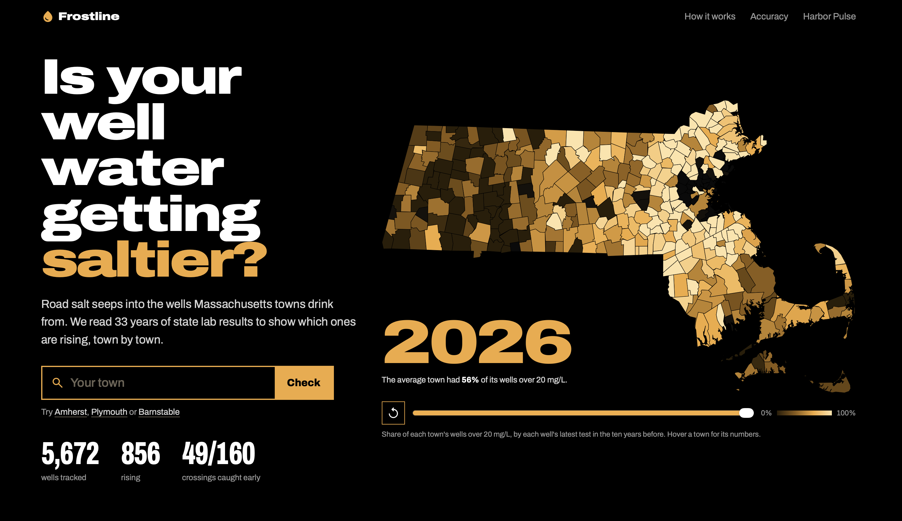
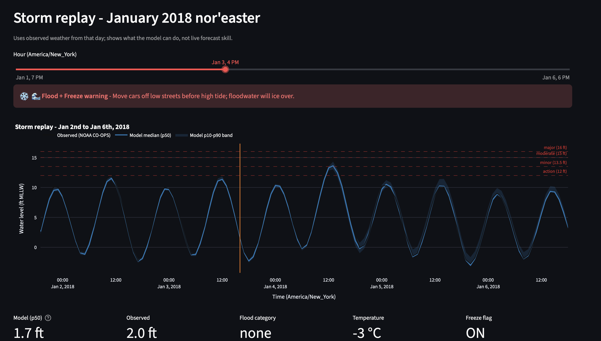

# Frostline

Tracking road salt in Massachusetts drinking water wells, building on UMass Amherst research that shows salt lingers in water supplies for decades.

Hackachusetts 2026, Climate Tech track. Live at [frostline.mohak.dev](https://frostline.mohak.dev). Its coastal companion, Harbor Pulse, is at [hackachusetts2026.streamlit.app](https://hackachusetts2026.streamlit.app) and linked from the site header.

## Problem

Massachusetts salts its roads every winter, and the salt soaks into the ground that many towns pull their drinking water from. UMass Amherst research on the Wachusett Reservoir found road salt lingers in water supplies for decades. Today 2,721 of the 5,379 public wells with a sodium test were over 20 mg/L at their last test, the MassDEP advisory level for people on low-sodium diets. The state publishes every result, but as raw rows nobody reads.

Winter also brings the sea. Nor'easters like the January 2018 storm push Boston Harbor into the streets, and floodwater that meets freezing air turns into ice.

## Features

### Frostline: salt in drinking water

- Statewide map of all 351 towns that plays back decades of sodium data, year by year.
- Search a town and the map zooms into its page: wells over 20 mg/L, wells getting saltier, wells on watch (under 20 now, on track to pass it), and the saltiest well.
- Every public well in a table with who drinks from it, its latest sodium, its trend and its own history chart.
- A checker that compares any well, or your own lab results, against the MassDOT road-salt triggers for your diet.
- Honest trends: a well is called rising only with 4+ tests over 5+ years and a significant trend. Otherwise it says "not enough data".
- Published accuracy: we hid every result after 2015 and checked the watch flag against what wells did later. It caught 49 of the 160 wells that crossed 20 mg/L, with 15 false alarms.
- Static site. A Python pipeline builds the data once, and the SvelteKit site loads nothing external, so it runs offline.

### Harbor Pulse: coastal flooding

- 72-hour water-level forecast for Boston Harbor from NOAA tide gauge data and weather forecasts, using LightGBM quantile regression.
- Odds of passing each National Weather Service flood stage, with an uncertainty band.
- A Flood + Freeze warning when floodwater is likely to meet freezing air.
- An hour-by-hour replay of the January 2018 nor'easter.

## Screenshots

**Frostline:** share of each town's wells over 20 mg/L sodium, with a time-lapse slider and town search.



**Harbor Pulse:** replay of the January 2018 nor'easter, with the median forecast and 10th-90th percentile band against NWS flood stages, and the Flood + Freeze warning.



## How we used Kiro

Both projects were built spec-first in Kiro IDE. Requirements, design and task lists came before any code, and steering files held the product rules, stack and data quirks. Specs and steering are in [`.kiro/`](.kiro). Autopilot ran 56 tasks across the Frostline pipeline and site. Kiro CLI added agent hooks and property-based tests (fast-check and Hypothesis) for the safety thresholds and trend rules; all 53 tests pass. The full write-up is in [`submission/kiro.md`](submission/kiro.md).

## Run it

Needs [bun](https://bun.sh). The data is committed, so no pipeline run is needed.

```sh
cd site
bun install
bun run build
bun run preview
```

## Data

- Sodium and chloride: MassDEP drinking water results through the EEA Data Lake API.
- Town borders: MassGIS.
- Thresholds: 20 mg/L sodium (MassDEP advisory for low-sodium diets) and the MassDOT road-salt triggers.
- Water levels: [NOAA CO-OPS](https://tidesandcurrents.noaa.gov/), Boston gauge 8443970.
- Weather: [Open-Meteo](https://open-meteo.com/) GFS forecasts and ERA5 history.

## Research

- Soper et al. 2021, *Journal of Hydrology*. Road salt in the Wachusett Reservoir watershed; chloride responds over decades, so only a sustained cut in salt use brings it down.
- Tiggeloven et al. 2021, [Exploring deep learning capabilities for surge predictions in coastal areas](https://doi.org/10.1038/s41598-021-96674-0), *Scientific Reports*. The base for Harbor Pulse's surge setup.
